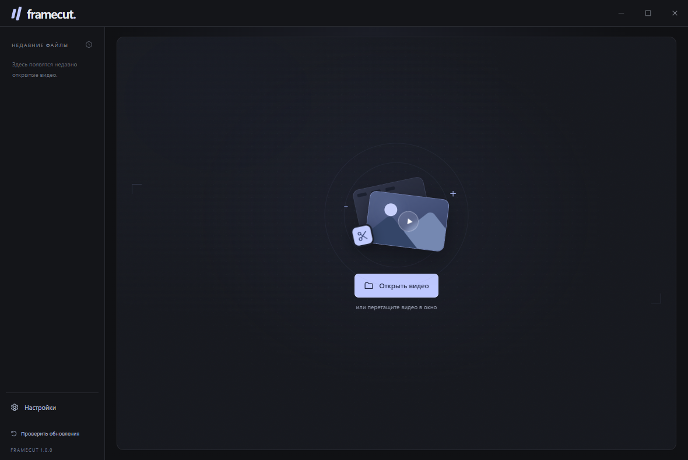

<p align="center">
  
</p>

<h1 align="center">Framecut</h1>

<p align="center">
  Видеоплеер с обрезкой для Windows.<br>
  Нужный фрагмент, простое управление и локальная обработка.
</p>

<p align="center">
  <a href="README.md">English</a>　·　<strong>Русский</strong>
</p>

<p align="center">
  <a href="https://github.com/Salvehn/framecut/releases/latest"><strong>Windows</strong></a>
 　·　
  <a href="https://github.com/Salvehn/framecut/releases/latest"><strong>Portable</strong></a>
 　·　
  <a href="https://github.com/Salvehn/framecut/releases"><strong>История версий</strong></a>
</p>

<p align="center">
  
  
  
  
</p>

<p align="center">
  
</p>

## Возможности

- **Удобный просмотр.** Перемотка, переход по кадрам, скорость, звук и полный экран.
- **Простая обрезка.** Границы на шкале, точный ввод времени и просмотр выделенного фрагмента.
- **Быстро по умолчанию.** Сохранение потоков без перекодирования или точная обрезка до кадра.
- **Два режима сохранения.** Новый файл или перезапись после проверки готового результата.
- **Поделиться фрагментом.** Временный MP4 без диалога сохранения: выбор получателя в Telegram, передача файла в Discord через буфер или перетаскивание.
- **Интеграция с Windows.** Контекстное меню Проводника и выбор плеера по умолчанию из настроек.
- **Подписанные обновления.** Загрузка проверенного установщика и обновление с перезапуском.
- **Спокойный интерфейс.** Четыре языка, пресеты размера окна, компактные элементы, свои скроллбары и плавные анимации.
- **Локальная обработка.** Без аккаунта и облака. Отправка видео только по вашему действию.

## Обрезать видео

1. Откройте файл или перетащите его в окно.
2. Переместите границы на шкале или задайте начало и конец.
3. Выберите **Быстрая** или **Точная**. Быстрая работает по ключевым кадрам, точная перекодирует фрагмент.
4. Наведите на **Сохранить**: **Сохранить** заменяет исходник, **Сохранить как…** создаёт новый файл.

При перезаписи готовый фрагмент проверяется и только затем заменяет оригинал. Плеер открывает обрезанное видео заново. При ошибке или отмене до замены оригинал остаётся целым. Успешную перезапись отменить нельзя.

Подробности о [форматах, горячих клавишах и ограничениях](docs/usage.md).

## Установка

| Вариант | Система | Скачать |
| --- | --- | --- |
| Установщик | Windows 10/11 x64 | [Установщик Windows](https://github.com/Salvehn/framecut/releases/latest) |
| Portable | Windows 10/11 x64 | [Запуск без установки](https://github.com/Salvehn/framecut/releases/latest) |

FFmpeg входит в сборку — дополнительные среды выполнения и кодеки не нужны. Установщик добавляет пункт **Открыть в Framecut** в меню видеофайлов. В Windows 11 он находится в **Показать дополнительные параметры**. Плеер по умолчанию выбирается через **Настройки → Сделать плеером по умолчанию** и системное окно Windows.

В установленной версии работают обновления из приложения и интеграция с Windows. Portable обновляется вручную со страницы релиза.

## Разработка

Нужны Windows x64, Node.js 24 и pnpm 11.25.0.

```powershell
pnpm install --frozen-lockfile
pnpm start
```

Проверки и сборка:

```powershell
pnpm test
pnpm test:smoke
pnpm build
```

Устройство приложения и системная регистрация описаны в [ARCHITECTURE.md](ARCHITECTURE.md), сборка и публикация — в [docs/releases.md](docs/releases.md).

## Лицензия

[GPL-3.0-or-later](LICENSE). Включённые компоненты и ссылки на их исходники: [THIRD_PARTY_NOTICES.md](THIRD_PARTY_NOTICES.md).
